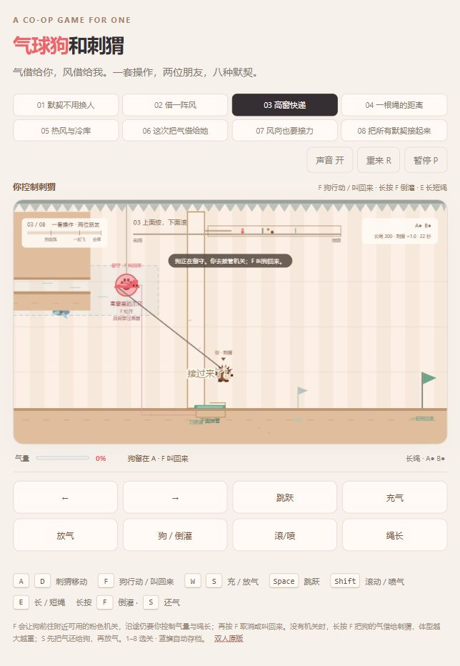

# 气球狗和刺猬 · 默契冒险

一个人的合作平台解谜游戏。你始终控制刺猬，F 让气球狗行动，不用切换角色。两位共用一根气管：气量、风、温度、绳长和体型会一起改变路线。

[在线试玩](https://andyyyuu.github.io/balloon-dog-hedgehog/) · [双人原版](https://andyyyuu.github.io/balloon-dog-hedgehog/duo.html)



## 操作

直接打开 `index.html` 即可游玩。桌面支持键盘，触屏设备有屏幕按钮。

| 按键 | 作用 |
|---|---|
| A / D | 始终移动刺猬 |
| F 短按 | 让狗前往附近可用的粉色机关；再按取消或叫回来 |
| F 长按 | 没有机关任务时，把狗的气倒灌给刺猬，让刺猬变大、变重 |
| W | 给狗充气；破掉后可以重新吹起来 |
| S | 刺猬变大时先把气还给狗，然后给狗放气 |
| E | 切换长绳 / 短绳 |
| Space | 刺猬跳跃 |
| Shift | 地面缩球滚动，空中向前喷气；喷气消耗狗的气量 |
| R | 重来当前关卡 |
| P / Esc | 暂停 / 继续 |
| M | 开关声音 |
| 1–8 | 自由选关 |
| Enter | 过关后进入下一关 |

狗的快捷行动仍会受到墙、窄缝和绳长限制，沿途需要调节气量。狗放光气后可以穿窄窗，风管能托住放扁的狗。刺猬变大后能压重机关、滚破厚墙，也会更重、更难起飞；缩小后才能钻矮洞。两位都怕仙人掌，狗还怕刺猬身上的刺。

横梁会挡住气管，气管会绕过梁角；向下的尖刺只在真正接触尖刺时造成伤害，平整背面可以站立。蓝旗会自动保存已经接管的机关。

## 八个组合关卡

1. **默契不用换人**：狗留守开门，刺猬滚压接管，再叫狗回来穿过矮道。
2. **借一阵风**：滚动开风，借浮力和横风越过刺丛、缺口，落地缩球撞墙。
3. **高窗快递**：狗充气升到高处，再放扁穿风管；刺猬从下面接管电源。
4. **一根绳的距离**：长绳绕梁，短绳躲吊刺；越过刺丛以后还要重新分开走高低两路。
5. **热风与冷库**：热区持续膨胀，冷区持续收缩；还要对付顺风、逆风和低矮出口。
6. **这次把气借给她**：倒灌变大，压开重机关、滚破厚墙，再还气缩小穿过矮洞。
7. **风向也要接力**：狗按到按钮后启动十二秒顺风，刺猬借风过刺丛、钻洞反锁，再让狗完成高处接力。
8. **把所有默契接起来**：高窗、冷热风、缺口、横梁、重压、厚墙，最后两位同时留守；狗的气量还要保持在 45%–68%。


## 修改与验证

发布文件 `index.html` 是完整的单文件游戏，无运行依赖。可编辑源码位于 `src/`：关卡在 `levels.js`，物理与控制在 `physics.js`，快捷行动和倒灌在 `mechanics.js`，绘制在 `render.js`。

修改源码后运行：

```sh
python tools/build.py
node tools/verify.cjs
```

验证包含八关完整键盘通关路线，以及固定控制归属、F 行动和召回、高窗碰撞、绕梁绳长、气量转移、重量机关、冷热变化、计时失败恢复与存档恢复。

GitHub Pages 从 `main` 分支根目录发布。旧六关双人游戏完整保留在 `duo.html`。
