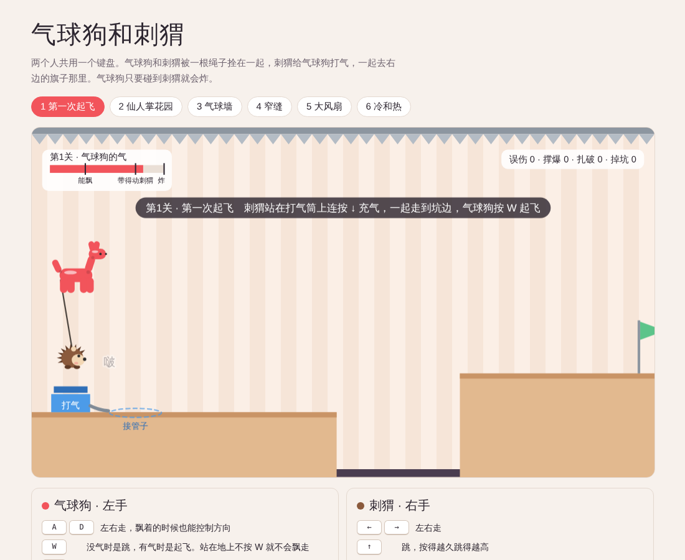

# 气球狗和刺猬

一个两人同键盘的合作平台跳跃原型。气球狗和刺猬被一根绳子拴在一起：刺猬给气球狗打气，气球狗把刺猬吊起来，一起飞到旗子那里。气球狗只要碰到刺猬就会炸。

## 怎么玩

直接用浏览器打开 `index.html`，先点一下画面，再按任意键开始。需要实体键盘。

**气球狗（左手）**

| 按键 | 作用 |
|---|---|
| A / D | 左右走，飘着的时候也能控制方向 |
| W | 没气时是跳，有气时是起飞；站在地上不按 W 就不会飘走 |
| S | 放气，会乱喷着往前飞；按住放光就变扁，能钻窄缝 |

**刺猬（右手）**

| 按键 | 作用 |
|---|---|
| ← / → | 左右走 |
| ↑ | 跳，按得越久跳得越高 |
| ↓ | 打气：站在打气筒上连按，或靠近气球狗按住吹气，靠近气球皮按住把它吹活 |
| 0 | 按住收绳，把两只拉近；松开绳子慢慢放长（小键盘的 0 也行） |
| / 或右 Shift | 按住缩成球：滚得快、会反弹，能撞破气球墙 |

其他：R 重来这一关，数字键 1–6 选关，过关后按 Enter 进下一关。

## 关卡

1. 第一次起飞：打气，起飞，飘过坑
2. 仙人掌花园：头顶有钉子，刺猬在地上拉着气球狗走，像放风筝
3. 气球墙：刺猬缩成球撞墙，球会反弹
4. 窄缝：气球狗放光气变扁，刺猬缩成球，一起钻过去
5. 大风扇：借风飞过大坑
6. 冷和热：热灯让气球狗变大，冷风让它缩小，最后撞开气球墙

## 部署到 GitHub Pages

把这个文件夹推到一个仓库，在仓库的 Settings → Pages 里选 `main` 分支、根目录，保存后就能用网址打开。

## 技术说明

单个 HTML 文件，纯 Canvas 2D 绘图，Web Audio 合成音效，没有依赖和构建步骤。标题字体从 Google Fonts 加载，离线时会退回系统字体。
