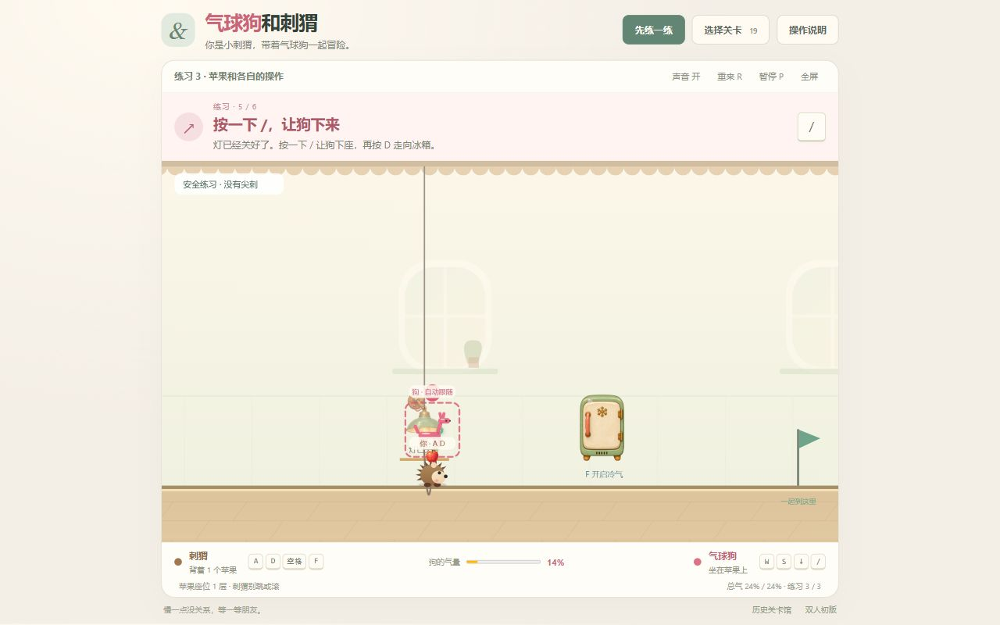
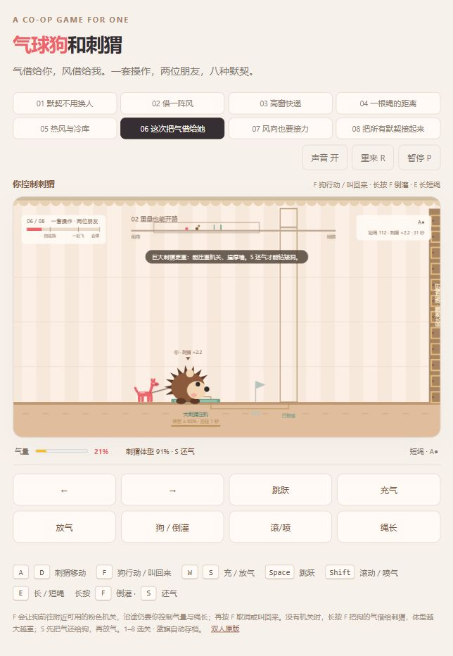

# 气球狗和刺猬 · 房间冒险

单人版以刺猬为主角：A/D 移动、空格跳、Shift 滚、F 操作。气球狗大部分时间自动跟随，自动坐苹果、跟跳、沿带电墙爬行；按 / 让它执行机关动作。W 给狗气，S 放气，↓ 把气还给刺猬。

[在线试玩](https://andyyyuu.github.io/balloon-dog-hedgehog/) · [全部历史关卡](https://andyyyuu.github.io/balloon-dog-hedgehog/archive/) · [双人初版](https://andyyyuu.github.io/balloon-dog-hedgehog/duo.html)

默认现在是**轻松版**，19 间房都降低难度，完整原难度保存在 [历史关卡馆](archive/solo-before-easy.html)。

目前共有 19 间房：3 间安全练习 + 16 间冒险。经典八关完整保留。设计稿篇只追加为 09–16 关，采用有限总气量、苹果座位、静电、刺豚、水位、猫和滑轨。独立双角房间版（16 关）、早期单人初稿、六关喷气版、四关机关接力版、八关旧操作版和双人初版全部可在历史关卡馆游玩。



## 轻松版

窄洞与高窗扩大，刺丛缩短并降低，缺口收窄，重量机关放宽，32 秒限时、慢滑轨、慢退水，以及更快的灯具作业和结冰。充气加入安全阀；苹果、钥匙和物品的操作范围扩大。全部机制和原关卡都保留。

[逐关调整及三轮通关记录](docs/easy-mode.md)

## 这一版的可读性与美术

- 机关使用生成的独立透明图片：爪印按钮、铜踏板、木门、风扇、气泵、灯、冰箱、鸟笼，以及苹果和睡猫。保留图片原始透明通道，亮灯、进度、连线与风向是实时绘制的反馈。
- 每间房一次显示一个当前目标、对应按键和角色颜色，目标位置用呼吸高亮指明。关卡集中在选择面板中，分为练习、经典和设计稿篇，完成状态在本机保存。
- 三间无尖刺练习房先教刺猬的走、跳、滚，再教气与绳，最后教自动上苹果座位、狗的 / 作业及刺猬的 F 操作。
- 窗口较矮时自动调整整幅画面的大小，保持地面与提示同时可见。

[素材及生成提示词](docs/art-direction.md)

## 单人操作

一起保留 `index.html` 和 `assets/` 即可游玩。桌面支持键盘，触屏显示对应按钮。首次进入直接从无尖刺练习开始。

| 角色 / 动作 | 按键 |
|---|---|
| 刺猬移动、跳跃 | A / D / Space |
| 刺猬操作、拿钥匙、开冰箱、堵排水口 | F |
| 刺猬给狗输气 / 吹活 | W（F 不输气） |
| 刺猬缩球滚动 | Shift |
| 狗的位置微调（通常不用） | ← / → / ↑ |
| 狗贴静电墙、进行高处作业 | / |
| 狗倒灌气给刺猬 | ↓ |
| 狗放气喷射 | S |
| 按住收绳，松开放长 | 0（含小键盘） |
| 经典篇切换长短绳 | E |
| 上一关 / 下一关 | [ / ]；也可直接点选关卡 |
| 重来 / 暂停 / 声音 | R / P 或 Esc / M |

苹果座位：刺猬捡好苹果后松开方向键，小狗会自己靠近、自动上座；/ 下座。

设计稿篇中，W 只在两位之间转移气，不会凭空补充。打气筒和水底气泡可补总气量；放气、爆掉会损失气。热冷只改变体积，储存的气不变。苹果只保护座位那一点，跳或重新缩球会掉苹果；静电会消失，碰水立即失效。

经典篇保留原来的气量和机关规则，粉色狗机关用 / 操作。旧版操作也完整留在历史页面。原有仙人掌仍伤害两位；新增图钉地板只扎狗。

## 经典篇 · 01–08（原关卡保留）

1. **默契不用换人**：狗留守开门，刺猬滚压接管，再叫狗回来穿过矮道。
2. **借一阵风**：滚动开风，借浮力和横风越过刺丛、缺口，落地缩球撞墙。
3. **高窗快递**：狗充气升到高处，再放扁穿风管；刺猬从下面接管电源。
4. **一根绳的距离**：长绳绕梁，短绳躲吊刺；越过刺丛以后还要重新分开走高低两路。
5. **热风与冷库**：热区持续膨胀，冷区持续收缩；还要对付顺风、逆风和低矮出口。
6. **这次把气借给她**：倒灌变大，压开重机关、滚破厚墙，再还气缩小穿过矮洞。
7. **风向也要接力**：狗按到按钮后启动十二秒顺风，刺猬借风过刺丛、钻洞反锁，再让狗完成高处接力。
8. **把所有默契接起来**：高窗、冷热风、缺口、横梁、重压、厚墙，最后两位同时留守；狗的气量还要保持在 45%–68%。



## 设计稿篇 · 09–16（新增）

9. **客厅 · 苹果座位**：低气房飞不起来，狗缩小坐上一个苹果，由刺猬驮过图钉地板。
10. **书房 · 拧掉热灯泡**：叠三层苹果，让狗在稳定座位上按住 / 拧灯；刺猬一动就会中断。
11. **洗衣房 · 她飞它爬**：气倒给刺猬，刺豚借风上升，瘪狗在毛衣毯蹭电后沿墙爬。
12. **浴室 · 堵住排水口**：刺豚堵口涨水，狗变成浮标；松开后利用水位和绳长撤到毛巾架。
13. **鸟笼 · 一口气的距离**：普通身体够不到笼里的气球锁，刺豚长刺扎破气球，让钥匙落下来。
14. **走廊 · 别吵醒猫**：安静地让瘪狗贴地走，滚动、跳跃、打气和放气的声音会吵醒猫。
15. **厨房 · 滑轨节拍**：滑轮自动前进，按住收绳会同时拉低狗、吊高刺猬，躲开上下交错的障碍。
16. **厨房 · 冰箱和烤箱**：开冰箱把水面冻成路，分头跳上冰面，烤箱旁提前分气通过矮门。

## 修改与验证

`index.html` 包含游戏逻辑，生成的透明图片放在 `assets/props/`，应一起部署。经典关卡定义在 `src/levels.js`，新增篇追加在 `src/memo-levels.js`。轻松版通过 `src/easy-levels.js` 生成独立变体。新增篇机制和绘制在 `memo.js`、`memo-render.js`。练习房追加在 `practice-levels.js`，逐步目标及高亮在 `experience.js`，图片绘制在 `prop-art.js`。不覆盖旧关卡或旧版本。

```sh
python tools/build.py
node tools/verify.cjs
node tools/verify-memo.cjs
node tools/verify-easy.cjs 1
node tools/verify-easy.cjs 2
node tools/verify-easy.cjs 3
python tools/verify-retention.py
```

旧脚本验证归档原难度，verify-easy 对当前 19 关分别使用三种按键采样与停顿节奏完整通关。检查还包括经典八关和新增八关的完整键盘通关路线、单人实体按键、自动跟随通关、空气守恒、冷热体积、苹果掉落、稳定高处作业、静电遇水失效、猫的声音反应、滑轨耦合，以及历史文件与经典关卡保留检查。

GitHub Pages 从 `main` 分支根目录发布。上一版分别操控双角的 16 关保存在 `archive/solo-rooms-independent.html`。所有历史版本入口为 `archive/index.html`。
