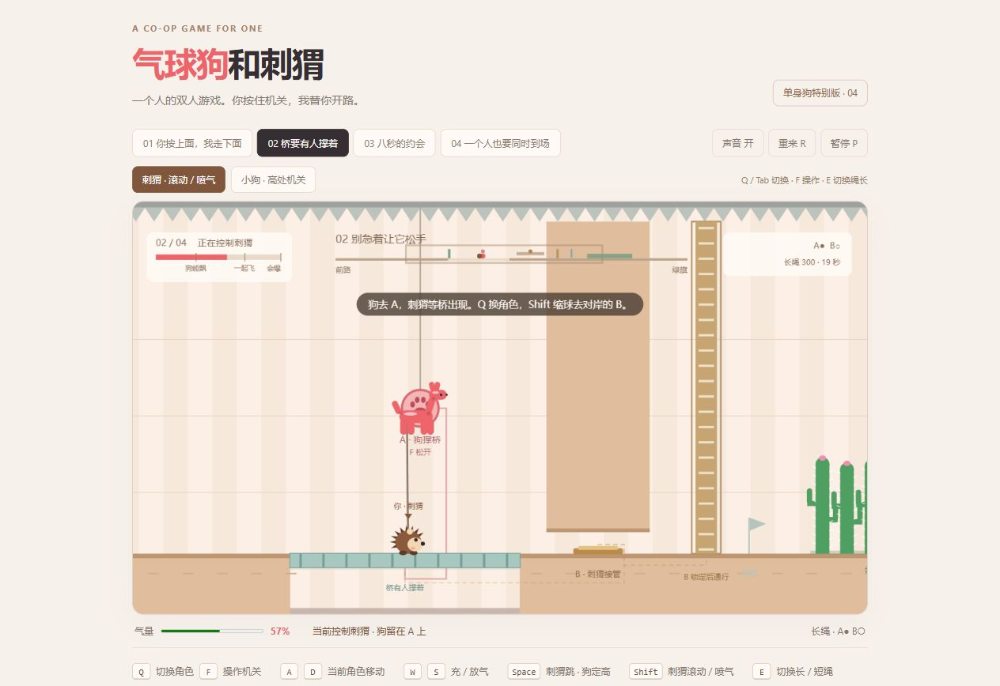

# 气球狗和刺猬 · 一人双角

一个人的双人合作平台解谜游戏。气球狗和刺猬被一根绳子拴在一起：你要切换角色，安排一位留守机关，再让另一位完成接力。粉色爪印只认气球狗，铜色机关需要刺猬操作。两位都怕仙人掌，要靠气球狗把刺猬吊起来越过刺丛。

[在线试玩](https://andyyyuu.github.io/balloon-dog-hedgehog/) · [双人原版](https://andyyyuu.github.io/balloon-dog-hedgehog/duo.html)

## 怎么玩

直接用浏览器打开 `index.html`，点击“一个人，一起出发”。桌面使用键盘，触屏设备有屏幕按钮。

| 按键 | 作用 |
|---|---|
| Q / Tab | 在刺猬和气球狗之间切换 |
| A / D | 移动当前角色 |
| F | 操作专属机关；狗扣住机关后会留守，再按 F 松开 |
| W / S | 给气球狗充气 / 放气 |
| Space | 刺猬跳跃；控制狗时按住定高（气量需超过 32%） |
| Shift | 刺猬在地上缩球滚动，在空中向前喷气；喷气消耗气球狗的气量 |
| E | 切换长绳 / 短绳；长绳适合分头行动，短绳适合一起飞行 |
| R | 重来当前关卡 |
| P / Esc | 暂停 / 继续 |
| M | 开关声音 |
| 1–4 | 直接选关 |
| Enter | 过关后进入下一关 |

气球狗放光气后能变扁穿过窄道，刺猬缩球后可以滚过矮洞并压下铜盘。蓝旗处会自动存档。向下的尖刺只在实际碰到尖刺时造成伤害，平整的背面可以站立。

## 四个配合关卡

1. **你按上面，我走下面**：狗留在高处开门，刺猬滚到另一侧反锁，然后回来接狗。
2. **桥要有人撑着**：狗维持桥，刺猬过桥钻矮洞接管；提前松手，桥会收回。
3. **八秒的约会**：狗启动八秒计时，两位越过刺丛，刺猬赶去反锁，再由狗操作出口机关。超时会回到安全位置重试。
4. **一个人也要同时到场**：两位同时维持机关直到计量充满。最后的轻压气阀还要求狗保持 45%–68% 的气量。

## 双人原版

原来的六关双人游戏保留在 `duo.html`，其中的操作说明和关卡保持原样。

## 部署与技术

GitHub Pages 从 `main` 分支根目录发布，首页为单人新版。游戏是单个 HTML 文件，使用 Canvas 2D 绘图和 Web Audio 合成音效，没有依赖或构建步骤。
